# Nhịp — Nghiên cứu cổ phiếu, đúng nhịp thị trường

**Nhịp** là ứng dụng web nghiên cứu cổ phiếu Việt Nam, giao diện tối, tối ưu cho bàn phím. Mỗi sáng người dùng nhận bản tin thị trường do AI tổng hợp, theo dõi danh mục, xem lịch sự kiện doanh nghiệp, đọc báo cáo tài chính, xem khuyến nghị của các công ty chứng khoán và lọc cổ phiếu, tất cả trong một nơi.

🔗 **Demo:** https://thean-investment.vercel.app — bấm **"Dùng tài khoản demo"** ở trang đăng nhập (hoặc mở thẳng [/dang-nhap?demo=1](https://thean-investment.vercel.app/dang-nhap?demo=1)).

> ⚠️ Toàn bộ dữ liệu là **dữ liệu mô phỏng** dùng để trình diễn giao diện, không phải khuyến nghị đầu tư. Tên công ty chứng khoán và nguồn tin trong ứng dụng đều là tên hư cấu.

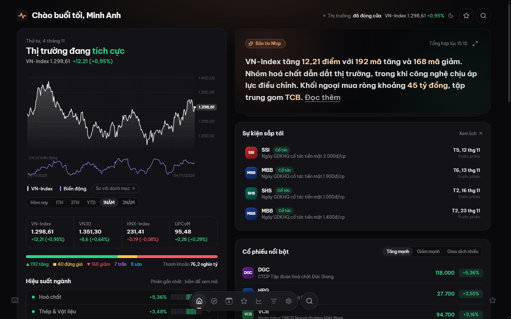

## Ảnh giao diện

| Trang giới thiệu | Bảng lệnh ⌘K |
|---|---|
| 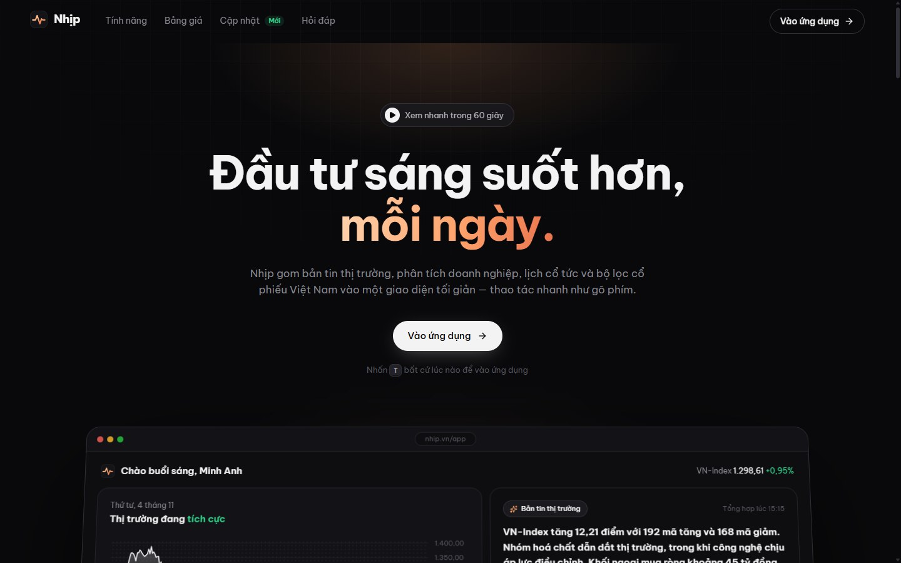 | 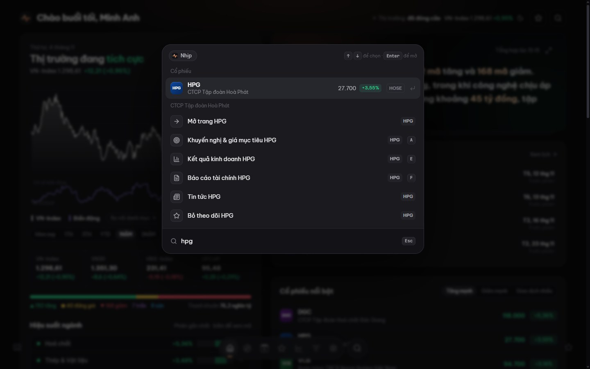 |
| **Trang cổ phiếu** | **Khuyến nghị & giá mục tiêu** |
| 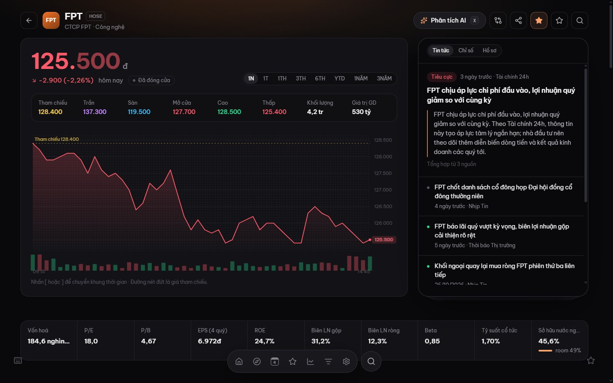 | 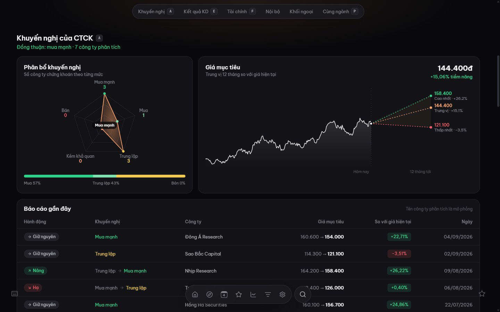 |
| **Báo cáo tài chính** | **Phân tích vĩ mô** |
| 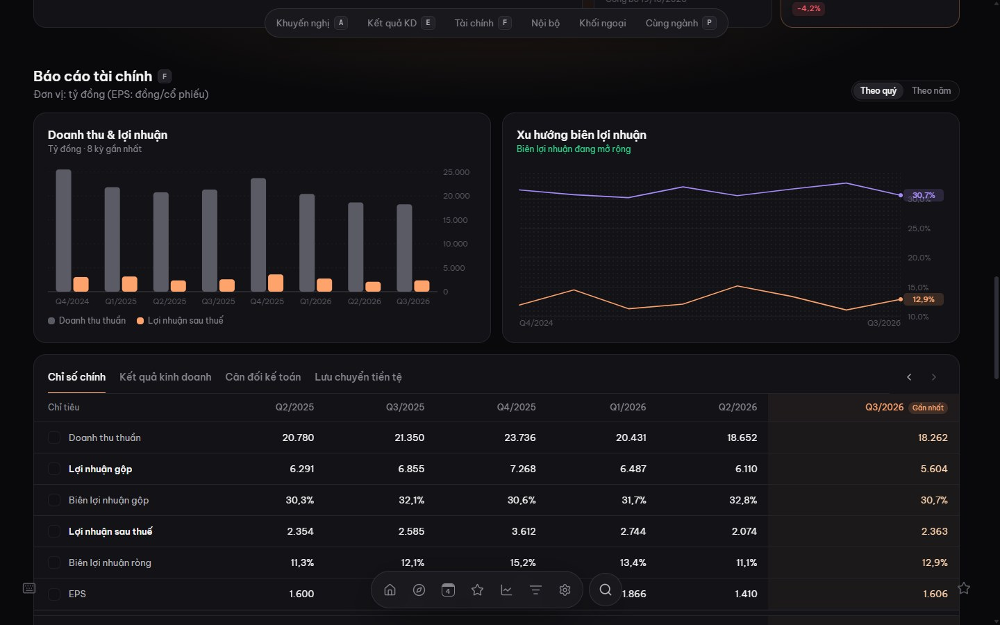 | 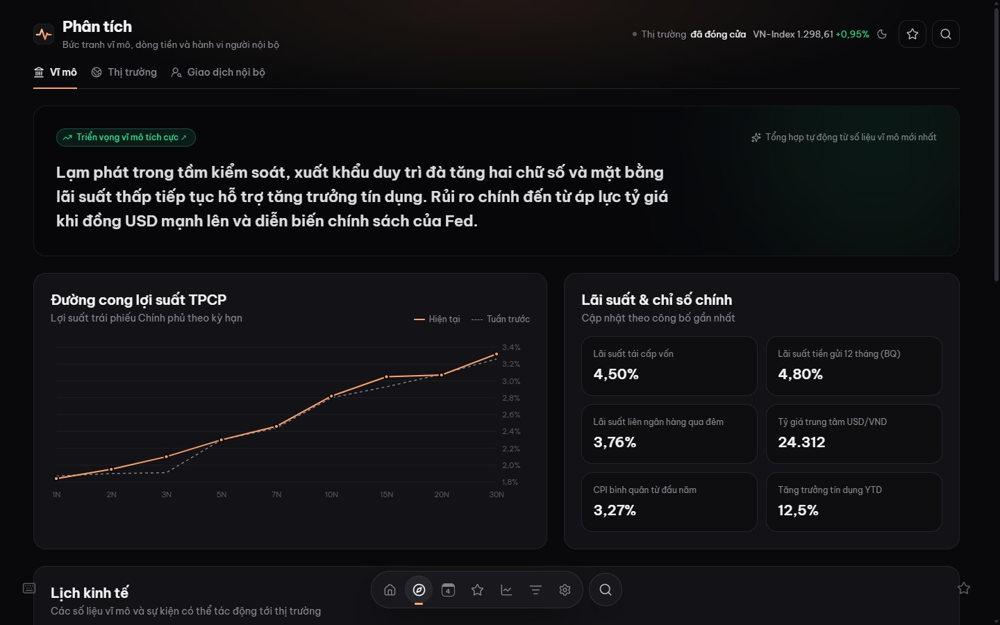 |
| **Danh sách theo dõi** | **Danh mục nắm giữ** |
| 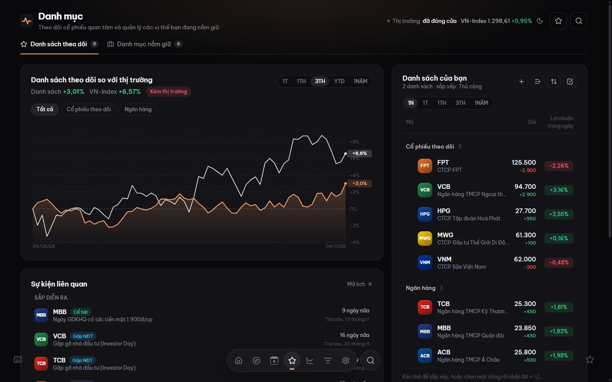 | 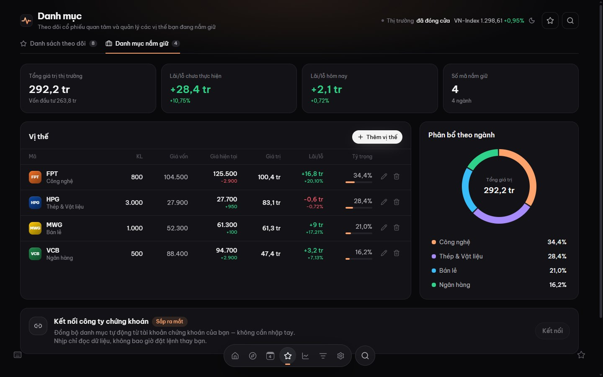 |
| **Lịch sự kiện** | **Bộ lọc cổ phiếu** |
| 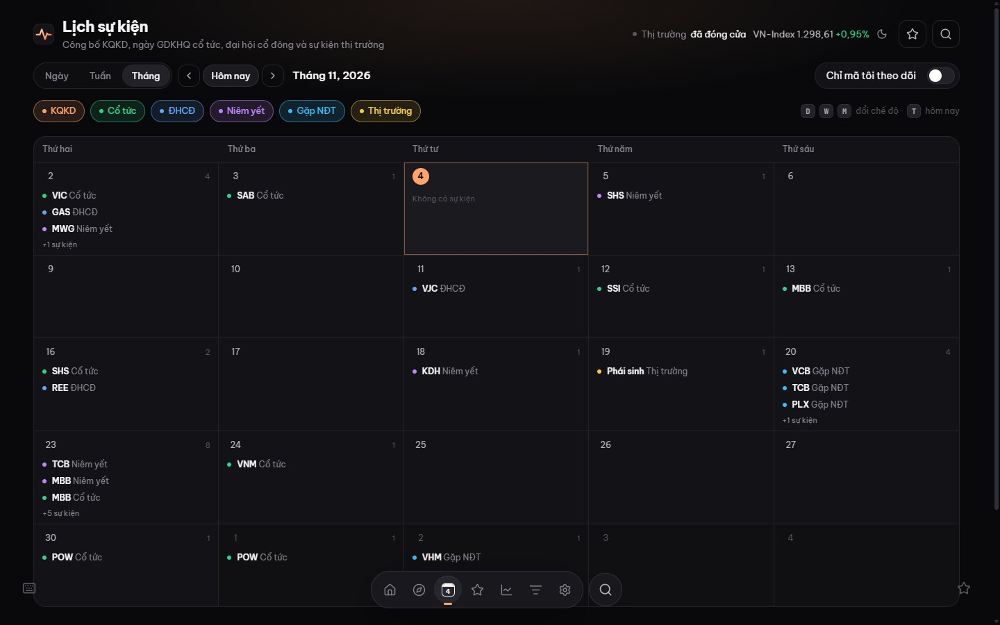 | 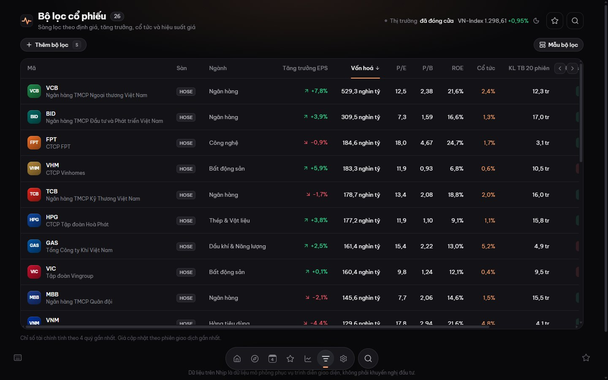 |
| **So sánh biểu đồ** | **Giao diện điện thoại** |
| 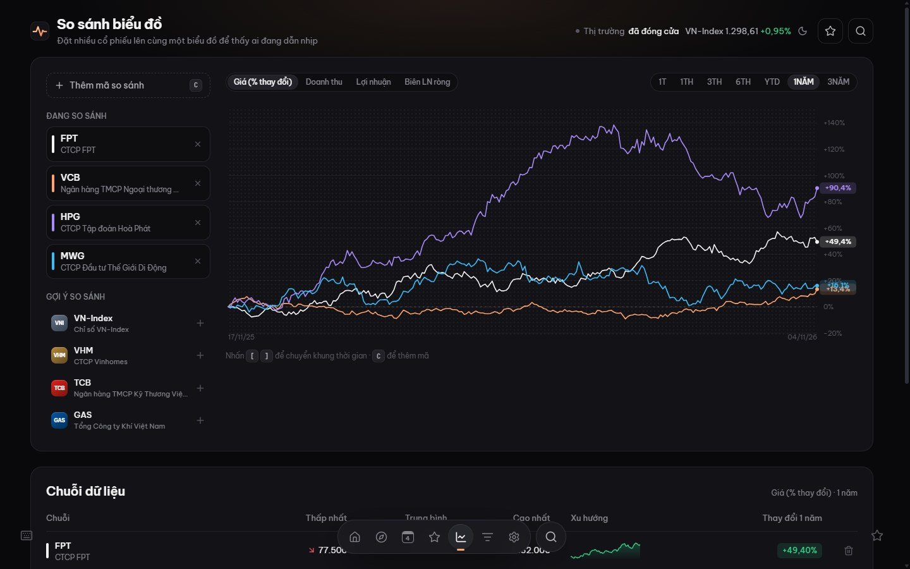 | 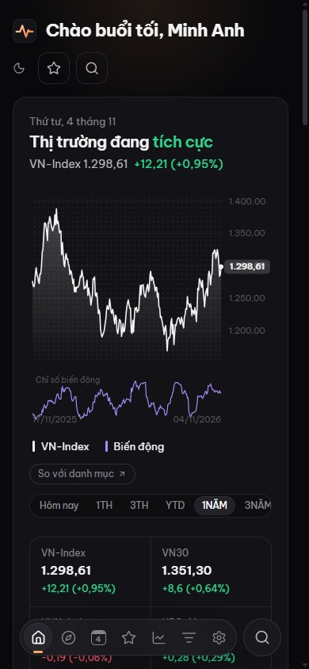 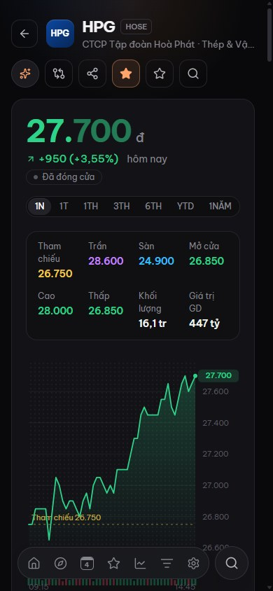 |

## Tính năng

| Màn hình | Nội dung |
|---|---|
| **Trang giới thiệu** | Hero, bản xem trước dùng dữ liệu thật, các tính năng, bảng giá VND, câu hỏi thường gặp |
| **Đăng nhập / Đăng ký** | Magic link qua email, tài khoản demo một chạm |
| **Bắt đầu** | Chọn ngành quan tâm, thêm mã theo dõi, hướng dẫn bảng lệnh ⌘K và phím tắt |
| **Tổng quan** | Tâm lý thị trường, VN-Index kèm chỉ số biến động, độ rộng thị trường, hiệu suất ngành, bản tin AI, khối ngoại, top biến động, tin tức |
| **Cổ phiếu** | Giá trần/sàn/tham chiếu, biểu đồ 1N→3N, chỉ số định giá, khuyến nghị CTCK và giá mục tiêu, kết quả kinh doanh so với dự phóng, báo cáo tài chính, giao dịch nội bộ, khối ngoại, so sánh cùng ngành, phân tích AI |
| **Phân tích** | Vĩ mô (lịch kinh tế, lợi suất TPCP), thị trường thế giới, giao dịch nội bộ toàn thị trường |
| **Lịch sự kiện** | Xem theo ngày / tuần / tháng: KQKD, GDKHQ cổ tức, ĐHCĐ, đáo hạn phái sinh |
| **Danh mục** | Nhiều danh sách theo dõi (kéo thả, chọn nhiều), danh mục nắm giữ với lãi/lỗ và phân bổ ngành |
| **So sánh** | Tối đa 6 mã: giá (%), doanh thu, lợi nhuận, biên lợi nhuận |
| **Bộ lọc** | Lọc theo sàn, ngành, vốn hoá, P/E, ROE, cổ tức…, có mẫu bộ lọc lưu được |
| **Cài đặt** | Tài khoản, tuỳ chọn hiển thị, gói thành viên, giới thiệu bạn bè, góp ý |

**Phím tắt:**
- `Ctrl/⌘ K` mở bảng lệnh, `/` tìm mã, `?` xem bảng phím tắt, `W` mở danh sách theo dõi.
- `G` rồi `H / A / C / W / G / S / ,` để chuyển trang.
- Trên trang cổ phiếu: `B` theo dõi, `[ ]` đổi khung thời gian, `A / E / F / P` nhảy tới từng mục.

## Công nghệ

- **Giao diện:** React 19, Vite 6, Tailwind CSS v4 (design token khai báo trong `@theme`).
- **Dữ liệu và trạng thái:** TanStack Query 5, Zustand 5, React Router 7 (lazy route).
- **Biểu mẫu:** React Hook Form + Zod.
- **Biểu đồ:** SVG tự viết, không dùng thư viện biểu đồ.
- **Font:** Be Vietnam Pro, JetBrains Mono.

## Chạy dự án

```bash
cd frontend
npm install
npm run dev        # http://localhost:5180
npm run build
```

Tài khoản demo: bấm **"Dùng tài khoản demo"** ở trang đăng nhập.

## Kiến trúc

```
frontend/src
├── api/            # http client + service; mock/ = mock server chạy trong trình duyệt
│   └── mock/       # market.js sinh dữ liệu tất định theo quy tắc thị trường VN
├── components/
│   ├── ui/         # design system: Button, Input, Modal, Segmented, TickMeter…
│   ├── charts/     # LineChart, BarChart, Sparkline (SVG)
│   ├── layout/     # AppLayout, Dock, CommandPalette, WatchPanel…
│   └── <tính năng>/
├── hooks/          # React Query hooks + phím tắt
├── pages/
└── styles/index.css  # token màu, typography, utilities
```

Tài liệu trong `docs/`:
- [DESIGN_SYSTEM.md](docs/DESIGN_SYSTEM.md): token, thành phần, quy ước.
- [API_CONTRACT.md](docs/API_CONTRACT.md): đặc tả API để viết backend.
- [SCREEN_MAP.md](docs/SCREEN_MAP.md): danh sách màn hình và route.

## Kết nối backend

1. Hiện thực các endpoint trong `docs/API_CONTRACT.md`.
2. Đặt `VITE_USE_MOCK=false` và `VITE_API_URL=https://api.example.com/api/v1` trong `frontend/.env`.
3. Thêm domain API vào `connect-src` của header CSP trong `frontend/vercel.json`.

## Deploy (Vercel)

Chọn Root Directory `frontend`, framework preset Vite. File `vercel.json` đã cấu hình sẵn:
- rewrite cho SPA,
- header bảo mật (CSP, HSTS, X-Frame-Options…),
- cache cho thư mục assets.
